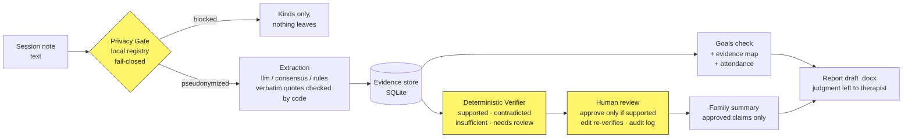

# Elo Evidence-to-Impact

**Evidence-first documentation for pediatric rehabilitation.**
**Documentação baseada em evidências para reabilitação infantil.**

Hack Brasil 2026 · Track: Health & well-being (Saúde & bem-estar) · **Status: working prototype, not clinically validated / protótipo funcional, sem validação clínica**

[English](#english) · [Português (Brasil)](#português-brasil)

---

## English

### The problem

AI can turn therapy notes into fluent reports, but fluency is not clinical evidence. A session observation made in a clinic must not become an unsupported claim that a child performs the same activity independently at home. Professionals need draft documentation they can inspect, correct and approve, and families deserve clear explanations of what is actually supported.

### Our approach

Elo Evidence-to-Impact is an independent prototype that turns **synthetic pediatric occupational therapy notes** into structured observations and auditable claims.

1. **Privacy Gate**: local patient registry, pseudonyms and pattern detectors; blocks on doubt.
2. **Structured extraction**: activity, action, environment, level of assistance, date and exact source passage.
3. **Evidence linking**: every statement links to its supporting observation, including who observed it or reported it.
4. **Context-Aware Evidence Verifier**: compares the constraints of a claim (environment, assistance, source of evidence, time) with those of the evidence and returns `supported`, `contradicted`, `insufficient_evidence` or `needs_review`.
5. **Human review**: a therapist approves, edits or rejects each statement, with an audit trail.
6. **Family summary**: built only from approved statements.
7. **Evidence gaps**: activity × environment (clinic, home, school) × period, showing what has not been directly observed.

> **Core principle:** *Not observed is not the same as achieved.* The software must be allowed to say "we don't know."

### Example (synthetic)

- Source: "In the clinic, the child completed the dressing task without physical assistance after verbal prompts."
- Unsupported claim: "The child dresses independently at home."
- Expected behavior: **insufficient evidence**. The source is from the clinic, not from home, and verbal prompts were required.

### What works today

An end-to-end, bilingual (pt-BR / English) web app and API, running on synthetic data:

- notes go through the **Privacy Gate** (names replaced by pseudonyms before any model sees them; unregistered personal data blocks the note);
- extraction with a language model **or** deterministic rules; every quoted passage is verified verbatim by code, and code (not the model) decides whether it was directly observed or reported;
- a **deterministic verifier** (independent of the model) returns `supported`, `contradicted`, `insufficient_evidence` or `needs_review`;
- **human review**: approve only if supported, edit re-verifies, reject needs a reason; append-only audit log;
- goals checked against evidence over time, an **evidence map** (activity × setting), attendance with an explicit adherence rule;
- a family summary from approved claims only, and a **.docx report draft** that leaves conclusions, ratings (GAS) and conduct to the therapist.



### Measured results (synthetic benchmark, 95 cases + 17 goal checks)

Engineering test of the automatic layer only, **not clinical validation**. Details, split rules and every disclosure are in [benchmark/README.md](benchmark/README.md).

| Set | Mode | Verdict accuracy | Unsafe `supported` |
|---|---|---|---|
| Development (59 cases) | model alone (`qwen2.5:3b`) | 94.9% | 0 |
| Development (59 cases) | consensus (rules + model must agree) | 84.7% | 0 |
| Sealed evaluation, run once (24 cases) | model alone / consensus | 95.8% / 83.3% | 1 / 1 |
| Sealed rounds 5 / 6 (designed to fail) | both modes, same result | 33% / 67% | 1 each |

**Honest limit:** every unsafe `supported` found was a family report read as direct observation under a phrasing the lists do not cover (for example "pelo que a vó contou"). Because of this, **human review with the quote and its source visible is mandatory** in the product, and "consensus" exists as a strict mode (`EXTRACTION_MODE=consensus`) that sends disagreements to the reviewer. The goal check passes 17 of 17 constructed cases. Labels were written by construction and await review by the occupational therapist.

### Run it

```bash
cd api && pip install -e ".[dev]" && python -m pytest -q          # 138 tests
ELO_WEB_DIR=../web python -m uvicorn elo.api:app_factory --factory --app-dir src   # app at /app/
```

Without a model configured the app uses the deterministic rules and says so on each note. To use a model set `LLM_BASE_URL`, `LLM_API_KEY`, `LLM_MODEL` (any OpenAI-compatible endpoint) and `EXTRACTION_MODE` (`llm`, `consensus` or `rules`). In the app, press **Load demo case** for an invented case. For a public deployment set `ELO_ACCESS_TOKEN`. `compose.yaml` runs landing, app and API behind Traefik (see the header of that file).

### Safety and boundaries

- **Synthetic data only** for development, demo and submission. No real patient data.
- No automatic diagnosis, treatment prescription or clinical prediction.
- Human professional approval is mandatory before documentation is finalized.
- Research prototype: not a medical device, not a production clinical record system, and not claimed to meet any regulatory or data-protection standard.
- Pseudonymization reduces risk but is not infallible anonymization.
- No proprietary instrument items or scoring schemes are reproduced.

### Technology plan

Static web app (vanilla JS, no build step; a deliberate simplification of the earlier Next.js plan) · Python, FastAPI, Pydantic · SQLite · python-docx · pytest · optional language model through any OpenAI-compatible API, with a deterministic fallback. Extensible through configurable *discipline packs* (occupational therapy first).

### Evaluation plan

The synthetic, adversarial benchmark is reported above, with counts, denominators, confusion matrix, abstentions and false alarms. It is an engineering test, not clinical validation. Next: the therapist reviews the labels and writes her own fictional case.

### Independence from Elo 1.0

This repository was created after the Hack Brasil 2026 opening session (2026-11-04 21:00 BRT) and contains new code only. It is related by idea to an earlier, separate prototype ("Elo 1.0") but does not reuse, import or depend on any of its code or history.

### Team

- Airton Justino de Oliveira Junior: product and engineering
- Raquel Cristina Delazari: occupational therapist, clinical domain

### Links

- Landing page: https://evidence.eloterapia.com.br
- Demo: *to be added*
- Video: *to be added*

### License

Apache License 2.0. See [LICENSE](LICENSE) and [NOTICE](NOTICE).

---

## Português (Brasil)

### O problema

A IA transforma anotações de terapia em relatórios fluentes, mas fluência não é evidência clínica. Uma observação feita na clínica não pode virar a afirmação, sem sustentação, de que a criança realiza a mesma atividade com independência em casa. Profissionais precisam de rascunhos que possam inspecionar, corrigir e aprovar, e as famílias merecem explicações claras do que de fato está sustentado.

### Nossa abordagem

O Elo Evidence-to-Impact é um protótipo independente que transforma **notas sintéticas de terapia ocupacional pediátrica** em observações estruturadas e afirmações auditáveis.

1. **Privacy Gate**: cadastro local de pacientes, pseudônimos e detectores de padrão; bloqueia na dúvida.
2. **Extração estruturada**: atividade, ação, ambiente, nível de assistência, data e o trecho exato de origem.
3. **Vínculo de evidências**: cada afirmação aponta para a observação que a sustenta, incluindo quem observou ou relatou.
4. **Context-Aware Evidence Verifier**: compara as restrições da afirmação (ambiente, assistência, origem da evidência, tempo) com as da evidência e devolve `supported`, `contradicted`, `insufficient_evidence` ou `needs_review`.
5. **Revisão humana**: a terapeuta aprova, edita ou rejeita cada afirmação, com trilha de auditoria.
6. **Devolutiva para a família**: gerada apenas de afirmações aprovadas.
7. **Lacunas de evidência**: atividade × ambiente (clínica, casa, escola) × período, mostrando o que não foi observado diretamente.

> **Princípio central:** *não observado não é o mesmo que alcançado.* O software precisa poder dizer "não sabemos".

### Exemplo (sintético)

- Fonte: "Na clínica, a criança realizou a tarefa de vestir-se sem assistência física, após instruções verbais."
- Afirmação sem sustentação: "A criança se veste de forma independente em casa."
- Comportamento esperado: **evidência insuficiente**. A fonte é da clínica, não de casa, e houve instruções verbais.

### O que funciona hoje

Um app web e uma API de ponta a ponta, bilíngues (pt-BR / inglês), com dados sintéticos:

- as evoluções passam pelo **Privacy Gate** (nomes viram pseudônimos antes de qualquer modelo ver o texto; dado pessoal não registrado bloqueia a nota);
- extração por modelo de linguagem **ou** regras determinísticas; todo trecho citado é verificado literalmente por código, e é o código (não o modelo) que decide se foi observação direta ou relato;
- um **verificador determinístico** (independente do modelo) devolve `supported`, `contradicted`, `insufficient_evidence` ou `needs_review`;
- **revisão humana**: só aprova se sustentada, editar reverifica, rejeitar exige motivo; trilha de auditoria somente de acréscimo;
- metas checadas contra a evidência ao longo do tempo, **mapa de evidências** (atividade × ambiente), presença com regra de adesão explícita;
- resumo para a família só com afirmações aprovadas e **rascunho de devolutiva em .docx**, que deixa conclusão, pontuação (GAS) e conduta para a terapeuta.


### Resultados medidos (benchmark sintético, 95 casos + 17 checagens de meta)

Teste de engenharia só da camada automática, **não é validação clínica**. Detalhes, regras de separação e todas as divulgações estão em [benchmark/README.md](benchmark/README.md).

| Conjunto | Modo | Acurácia do veredito | `supported` inseguro |
|---|---|---|---|
| Desenvolvimento (59 casos) | só o modelo (`qwen2.5:3b`) | 94,9% | 0 |
| Desenvolvimento (59 casos) | consenso (regras + modelo precisam concordar) | 84,7% | 0 |
| Avaliação fechada, rodada uma vez (24 casos) | só o modelo / consenso | 95,8% / 83,3% | 1 / 1 |
| Rodadas fechadas 5 / 6 (feitas para falhar) | os dois modos, mesmo resultado | 33% / 67% | 1 cada |

**Limite honesto:** todo `supported` inseguro encontrado foi um relato da família lido como observação direta, com uma redação que as listas não cobrem (por exemplo "pelo que a vó contou"). Por isso, **a revisão humana, com o trecho e a fonte visíveis, é obrigatória** no produto, e o "consenso" existe como modo estrito (`EXTRACTION_MODE=consensus`) que manda as divergências para a revisora. A checagem de metas passa em 17 de 17 casos construídos. Os gabaritos foram escritos por construção e aguardam revisão da terapeuta ocupacional.

### Como rodar

```bash
cd api && pip install -e ".[dev]" && python -m pytest -q          # 138 testes
ELO_WEB_DIR=../web python -m uvicorn elo.api:app_factory --factory --app-dir src   # app em /app/
```

Sem modelo configurado o app usa as regras determinísticas e avisa em cada nota. Para usar um modelo, defina `LLM_BASE_URL`, `LLM_API_KEY`, `LLM_MODEL` (qualquer endpoint compatível com OpenAI) e `EXTRACTION_MODE` (`llm`, `consensus` ou `rules`). No app, use **Carregar caso de demonstração** para um caso inventado. Em implantação pública defina `ELO_ACCESS_TOKEN`. O `compose.yaml` sobe landing, app e API atrás do Traefik (veja o cabeçalho do arquivo).

### Segurança e limites

- **Somente dados sintéticos** em desenvolvimento, demonstração e submissão. Nenhum dado real de paciente.
- Sem diagnóstico, prescrição de tratamento ou previsão clínica automáticos.
- A aprovação de uma profissional é obrigatória antes de finalizar qualquer documentação.
- Protótipo de pesquisa: não é dispositivo médico, nem prontuário em produção, e não alegamos conformidade com norma regulatória ou de proteção de dados.
- Pseudonimização reduz risco, mas não é anonimização infalível.
- Nenhum item ou pontuação de instrumento proprietário é reproduzido.

### Plano de tecnologia

App web estático (JS puro, sem etapa de build; simplificação deliberada do plano anterior com Next.js) · Python, FastAPI, Pydantic · SQLite · python-docx · pytest · modelo de linguagem opcional por qualquer API compatível com OpenAI, com contingência determinística. Extensível por *discipline packs* configuráveis (terapia ocupacional primeiro).

### Plano de avaliação

O benchmark sintético adversarial está nos resultados acima, com contagens, denominadores, matriz de confusão, abstenções e falsos alertas. É um teste de engenharia, não validação clínica. Próximo passo: a terapeuta revisa os gabaritos e escreve o próprio caso fictício.

### Independência do Elo 1.0

Este repositório foi criado depois da sessão de abertura do Hack Brasil 2026 (04/11/2026, 21h BRT) e contém apenas código novo. Tem relação de ideia com um protótipo anterior e separado ("Elo 1.0"), mas não reutiliza, importa nem depende de nenhum código ou histórico dele.

### Equipe

- Airton Justino de Oliveira Junior: produto e engenharia
- Raquel Cristina Delazari: terapeuta ocupacional, domínio clínico

### Links

- Landing page: https://evidence.eloterapia.com.br
- Demo: *a adicionar*
- Vídeo: *a adicionar*

### Licença

Apache License 2.0. Veja [LICENSE](LICENSE) e [NOTICE](NOTICE).
